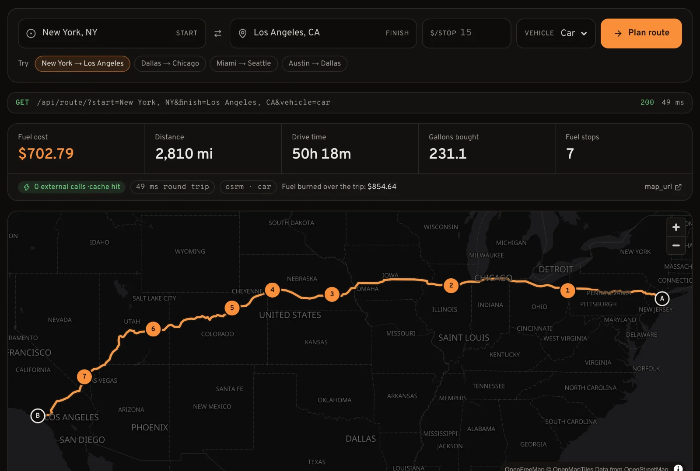
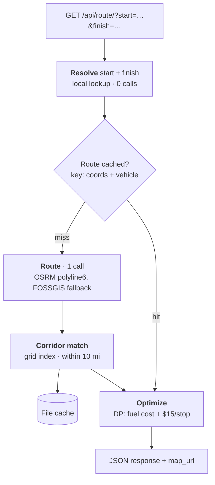

<h1 align="center">Fuel Route API</h1>

<p align="center">
  Give it two US places. Get back the driving route, the cheapest fuel stops for a 500-mile-range, 10 MPG truck, and the total fuel cost.<br>
  One external call per request, zero on a cache hit.
</p>

<p align="center">
  <a href="https://github.com/itsmrad/fuel-route-api/actions/workflows/ci.yml"></a>
  
  
  
  
</p>

<p align="center">
  <a href="docs/content/docs/index.mdx"><b>Docs</b></a> ·
  <a href="docs/content/docs/route-planner.mdx"><b>Route Planner</b></a> ·
  <a href="docs/content/docs/api/plan-route.mdx"><b>API Reference</b></a> ·
  <a href="docs/content/docs/engineering-decisions.mdx"><b>Engineering decisions</b></a> ·
  <a href="postman_collection.json"><b>Postman collection</b></a>
</p>

<p align="center">
  <picture>
    <source media="(prefers-color-scheme: light)" srcset=".github/assets/route-planner-light.webp">
    
  </picture>
</p>

> **Live demo:** (added after deployment). Until then, run it locally with `docker compose up` and open http://localhost:3000/docs.

## Results at a glance

| Metric | Result |
| --- | --- |
| **Cold request** (1 OSRM call) | p50 **421 ms** · p95 838 ms |
| **Cached request** (0 external calls) | p50 **9.5 ms** · p95 23 ms |
| **External calls** | **1** cold · **0** cached or on a `stop_penalty` change |
| **Savings vs a naive driver** | **12.3% ($382.77)** cheaper over 12 US routes ($2,718.99 vs $3,101.76) |
| **Stations placed offline** | **97.2%** (6,443 of 6,626 US stations), 0 geocoding calls at request time |
| **Tests** | **39** passing, no network (routing providers mocked) |

Measured with `manage.py benchmark` on 12 routes (196 to 3,304 mi), gunicorn `-w 2 --threads 4 -k gthread`, dev laptop against public OSRM. Details: [benchmarks](docs/content/docs/benchmarks.mdx).

## Requirements → how they're met

| Requirement | How | Evidence |
| --- | --- | --- |
| Django, latest stable | Django 6.1.2, plain `JsonResponse`, no DRF | [`api/pyproject.toml`](api/pyproject.toml) |
| Start and finish in the USA | `"City, ST"` and `"lat,lon"` resolve locally (Census Gazetteer); other text falls back to Nominatim; non-US input → `400` | [`geo.py`](api/routing/geo.py) |
| Map of the route | `map_url` in every response (Leaflet page, numbered stops); GeoJSON line in the JSON; interactive planner in the docs | [map template](api/routing/templates/routing/map.html), [planner](docs/content/docs/route-planner.mdx) |
| Cost-effective fuel stops | DP over (station, fuel level) minimising fuel cost + `$15` per stop; checked against brute force | [`optimizer.py`](api/routing/optimizer.py), [optimizer docs](docs/content/docs/optimizer.mdx) |
| 500-mile range, multiple stops | Range is a hard constraint across the whole route; a gap over 500 mi → `422` | [`test_optimizer.py`](api/routing/test_optimizer.py) |
| Total cost at 10 MPG | `total_fuel_cost` (bought on the way) and `cost_of_fuel_consumed`; money in `Decimal` | [`optimizer.py`](api/routing/optimizer.py) |
| Use the provided price CSV | Deduplicated and geocoded once by `load_stations` | [`fuel-prices.csv`](api/data/fuel-prices.csv), [data docs](docs/content/docs/data.mdx) |
| Free map/routing API | OSRM public server (no key); keyless OSM-based tiles (CARTO on the map page, OpenFreeMap in the planner) | [architecture](docs/content/docs/architecture.mdx) |
| 1 routing call (2–3 ok) | 1 typical, 0 cached; worst case 3 (truck → Valhalla, then OSRM, then FOSSGIS OSRM); reported as `external_api_calls` | [`test_views.py`](api/routing/test_views.py) |
| Fast | Cold p50 421 ms (mostly OSRM), cached p50 9.5 ms | [benchmarks](docs/content/docs/benchmarks.mdx) |
| Postman demo | 12 requests with assertions | [`postman_collection.json`](postman_collection.json) |

## How it works



The cache key is the resolved coordinates and vehicle, not the raw text, so a respelled city or a new `stop_penalty` re-runs only the optimizer (~9 ms, 0 calls). See [architecture](docs/content/docs/architecture.mdx) and [engineering decisions](docs/content/docs/engineering-decisions.mdx).

## Quickstart

**Docker** (first build takes a few minutes; the image ships with stations loaded):

```bash
docker compose up    # docs + route planner on :3000, API on :8000
```

**Local** (needs [uv](https://docs.astral.sh/uv/), which installs Python 3.14, and Node 20+):

```bash
# API on http://127.0.0.1:8000 (manage.py turns DEBUG on for local dev)
cd api && uv sync && uv run python manage.py migrate
uv run python manage.py load_stations   # downloads the Census Gazetteer once, prints "matched: 6443 (97.2%)"
uv run python manage.py runserver

# Docs + route planner on http://localhost:3000 (proxies /api/* to :8000)
cd docs && npm install && npm run dev
```

**Try it:**

```bash
curl -s 'http://127.0.0.1:8000/api/route/?start=Dallas,%20TX&finish=Chicago,%20IL'
```

<details>
<summary>Real response (route coordinates trimmed)</summary>

```json
{
  "start": { "query": "Dallas, TX", "lat": 32.7933, "lon": -96.7665 },
  "finish": { "query": "Chicago, IL", "lat": 41.837, "lon": -87.6849 },
  "distance_miles": 961.0,
  "duration_hours": 17.0,
  "routing": { "provider": "osrm", "profile": "car", "fallback": false },
  "fuel_stops": [
    { "mile": 161.6, "name": "EXTRA MILE TRUCK STOP", "address": "I-30 EXIT 208", "city": "Hooks", "state": "TX",
      "lat": 33.4707, "lon": -94.2865, "price": 2.817, "gallons": 16.1, "cost": 45.36 },
    { "mile": 648.0, "name": "HUCKS FOOD & FUEL #379", "address": "I-57, EXIT 53", "city": "Marion", "state": "IL",
      "lat": 37.7344, "lon": -88.9412, "price": 2.929, "gallons": 30.1, "cost": 88.16 }
  ],
  "total_gallons_purchased": 46.2,
  "total_fuel_cost": 133.52,
  "cost_of_fuel_consumed": 277.74,
  "stop_penalty": 15.0,
  "route": { "type": "LineString", "coordinates": [[-96.76642, 32.79325], [-96.76619, 32.79338], "…"] },
  "map_url": "http://127.0.0.1:8000/api/route/map/?start=Dallas%2C+TX&finish=Chicago%2C+IL&stop_penalty=15.0&vehicle=car",
  "external_api_calls": 1
}
```

</details>

The truck starts with a full tank, so `total_fuel_cost` is fuel bought on the way (0 for trips under 500 mi); `cost_of_fuel_consumed` prices every gallon burned.

**Tests:** `cd api && uv run python manage.py test` · **Postman:** import [`postman_collection.json`](postman_collection.json) (`baseUrl` defaults to `http://127.0.0.1:8000`).

## API

| Endpoint | Parameters | Returns |
| --- | --- | --- |
| `GET /api/route/` | `start`, `finish` (required: `"City, ST"`, `"lat,lon"`, or free text via Nominatim) · `stop_penalty` (USD ≥ 0, default `15`; `0` = cheapest fuel) · `vehicle` (`car` default, or `truck` via Valhalla) | Route, fuel stops, costs, `routing`, `map_url`, `external_api_calls` |
| `GET /api/route/map/` | same | HTML map of the route and stops |
| `GET /api/openapi.yaml` | | OpenAPI 3.1 spec |

Errors are JSON `{"error", "detail"}`: `400` missing/invalid parameter or unknown/non-US location · `422` fuel gap over 500 mi or no road · `502` routing provider down or slow. Full reference: [API docs](docs/content/docs/api/plan-route.mdx), [errors](docs/content/docs/errors.mdx).

## Tech stack

| Layer | Choice |
| --- | --- |
| API | Django 6.1, Python 3.14, uv, `requests`, gunicorn (gthread) |
| Data | SQLite + in-memory grid index; Census 2024 Gazetteer for station coordinates |
| Routing | OSRM public (car), FOSSGIS OSRM fallback, Valhalla public (opt-in truck) |
| Cache | Django `FileBasedCache`, shared across gunicorn workers |
| Docs | Next.js 16, Fumadocs, OpenAPI playground, MapLibre + OpenFreeMap |
| Ops | Docker Compose, GitHub Actions CI |

**Deliberately not used:**
- **DRF**: one read-only endpoint; `JsonResponse` + an OpenAPI file is enough.
- **PostGIS**: 6,626 points fit a stdlib grid index that matches a corridor in ~5 ms.
- **Redis / Celery**: one box, no background work; the file cache is shared across workers.
- **Keyed routing APIs** (ORS, GraphHopper, HERE): rate-limited or need an account; OSRM needs neither.
- **Request-time geocoding**: stations are placed offline once, so requests never wait on a geocoder.

## Repository layout

```
api/                         Django project (uv)
  config/                    settings, urls, wsgi (warms indexes at startup)
  routing/
    geo.py                   location resolver, OSRM/Valhalla client, corridor match
    optimizer.py             plan_fuel_stops(): stop-penalty DP
    views.py                 /api/route/, /api/route/map/, /api/openapi.yaml
    management/commands/     load_stations, geocode_stations, benchmark
    test_*.py                39 tests
  data/                      fuel-prices.csv, station_coords.csv
  openapi.yaml               OpenAPI 3.1 spec
docs/                        Fumadocs site: guides, route planner, API reference
postman_collection.json      12 requests with assertions
compose.yaml                 docker compose up → :3000 + :8000
```

## Limits and next steps

- **Station precision:** most stations sit at their city centroid (11.5% address-geocoded). The 10-mile corridor absorbs this (plans were unchanged after geocoding); next is exit-number lookup for `I-xx, EXIT nn` addresses.
- **Public routing servers** are best-effort and rate-limited; self-hosted OSRM is a one-function swap in `get_route`.
- **Truck routing is opt-in:** public Valhalla caps trips at 1,500 km, so coast-to-coast falls back to OSRM car. Self-hosted Valhalla would make `truck` the default.
- **Sparse West Coast data:** only 8 California stations, so NYC → LA has no station for its last ~273 mi (still within range).
- **Fixed assumptions:** 500 mi, 10 MPG, full tank at start, price snapshot. `range`, `mpg` and `start_fuel` parameters and a scheduled price refresh are straightforward additions.
- **Single box:** file cache and in-memory index; Redis and PostGIS when there is more than one box or many more stations.

## Further reading

Docs site: run locally at http://localhost:3000/docs. Source pages:
[Overview](docs/content/docs/index.mdx) ·
[Quickstart](docs/content/docs/quickstart.mdx) ·
[Architecture](docs/content/docs/architecture.mdx) ·
[Optimizer](docs/content/docs/optimizer.mdx) ·
[Data & geocoding](docs/content/docs/data.mdx) ·
[Engineering decisions](docs/content/docs/engineering-decisions.mdx) ·
[Benchmarks](docs/content/docs/benchmarks.mdx) ·
[Deployment](docs/content/docs/deployment.mdx) ·
[Limits](docs/content/docs/limits.mdx) ·
[Errors](docs/content/docs/errors.mdx)
